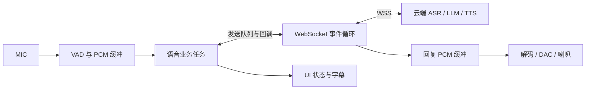

# AC791N 实时智能语音助手

在杰理 AC791N / WL82 Hello 工程上开发的智能语音终端。设备复用 MIC、音频服务、WiFi 和 LCD，经 OneSDK / libwebsockets 接入火山硬件智能体，云端执行 ASR → LLM → TTS，设备接收并播放回复。

本仓库提供 **应用代码、SDK 修改覆盖层、UI 资源和复现说明**，需要配套上游 SDK，不是可在桌面系统独立运行的软件。

## 实际功能

- 动态注册、获取语音网关配置、WebSocket 鉴权与实时会话。
- 16kHz / 16bit / 单声道 PCM 上行，Base64 音频事件与流式回复播放。
- VAD 对话分轮、等待回复与播放完成处理。
- 用户插话时取消云端回复并清空本地待播数据，补发前置缓存，减少句首丢失。
- 空闲 PING、断开后重建会话、按键音量与对话字幕。

## 关键代码

| 路径（均位于 overlay 下） | 作用 |
| --- | --- |
| `apps/demo/demo_hello/hello_realtime_voice.c` | 会话主流程、VAD 分轮、打断与前置缓存 |
| `apps/demo/demo_hello/include/hello_realtime_voice.h` | 功能开关和留空的接入配置 |
| `apps/common/LLM/onesdk/src/infer_realtime_ws.c` | 鉴权适配、发送队列、事件循环及保活 |
| `apps/common/LLM/onesdk/src/onesdk_rt.c` | 音频、文本及会话事件回调 |
| `apps/common/LLM/audio/audio_input.c` | 音频采集、播放缓冲及音量接口 |
| `apps/common/example/Devkitboard_test/ui_main.c` | 聊天页、刷新与交互处理 |
| `apps/demo/demo_hello/board/wl82/AC791N_DEMO_DEMO_HELLO.cbp` | Code::Blocks 工程 |

## 复现步骤

1. 获取 [上游 SDK](https://gitee.com/Jieli-Tech/fw-AC79_AIoT_SDK)，切换到基线 `0617f4cc09685332aaf1104893718291c54ee5bb`，在独立副本上操作。
2. 在仓库根目录运行 `python apply_overlay.py --sdk "你的 SDK 副本路径"`，按相同结构覆盖项目文件并自动解压生成图片源码。会覆盖目标副本内的同名文件，请使用单独的基线副本。保留上游其他文件和库。
3. 使用杰理官方 pi32v2 工具链与 Code::Blocks，打开 Hello 的 `.cbp`；如本机安装位置不同，调整工具链搜索路径。
4. 在自己的本地副本中填写 `hello_realtime_voice.h` 的云端实例、产品、设备和智能体配置；在 `wifi_demo_task.c` 填写 WiFi。**不要把填写后的配置提交到公开仓库。**
5. 检查 SDK 的功能宏、MIC 通道、屏幕及板级配置是否匹配硬件；联网后依次确认注册、配置获取、WebSocket、session 和音频事件。
6. UI 使用配套 ILI9488 320×480 / FT6236 工程。`ui_project/` 为界面源与素材，`overlay/cpu/wl82/tools/ui_res/` 为当前配套资源；更换硬件或修改 UI 后应通过厂商 UI 工具重新生成并同步资源 ID。
7. Clean → Rebuild 后按厂商流程烧录。验收应包含麦克风输入、喇叭完整播放、插话、音量和断线场景。

## 调试经验

- **发送队列有数据却没有网络输出**：事件循环检查 ring 并触发 writable，入队补充 `lws_cancel_service`；不能只看“入队成功”。
- **101 成功却没有下行事件**：分段检查设备、网关和云端模型配置。本项目排查记录中曾确认智能体推理接入点失效。
- **打断后句首缺失**：VAD 确认前的 PCM 不能直接丢弃，保留前置缓存并在新一轮补发。
- **UI 回调绘制导致重入**：用状态标志和定时刷新分离事件与绘制，校验控件文本长度与列表指针。

## 验证范围

历史开发板联调记录确认语音输入、云端回复及喇叭输出已跑通，并包含 UI、按键和打断问题的修复。当前覆盖层来自本地源码快照；本次公开整理仅做文件、配置清理与工程引用检查，未重新烧板验收。不同云产品配置或 SDK 版本可能需要重新适配。

没有提供未经测试的延迟、准确率、长期稳定性或优化百分比。ASR/LLM/TTS 在云端执行，不是端侧模型训练或 NPU 推理项目。

## 代码来源

基于杰理 SDK 和示例二次开发，包含协作编写与调试的应用代码。上游基线、许可和发布范围见 [UPSTREAM.md](UPSTREAM.md)，源文件清单与摘要见 `SOURCE_MANIFEST.json`。仓库不包含本地凭据、课程原文、云端账号信息、完整 SDK 二进制库或编译产物。

生成的 `logo.c` 采用 `logo.c.gz` 无损存放，由覆盖脚本恢复；图形资源不作为个人算法源码展示。
