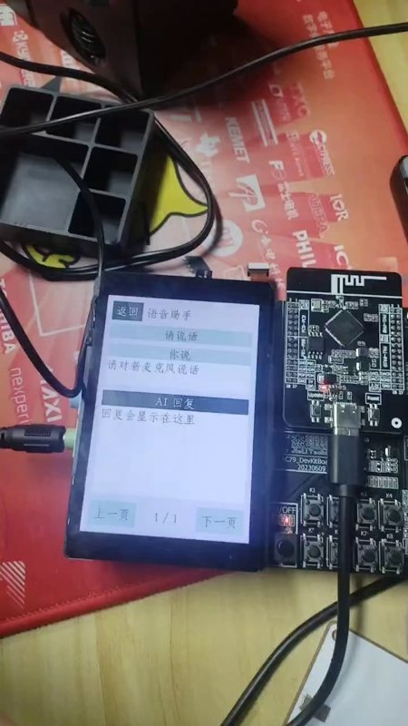
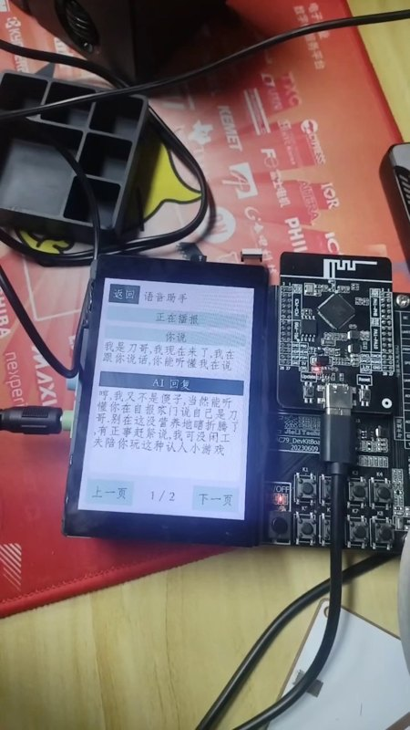
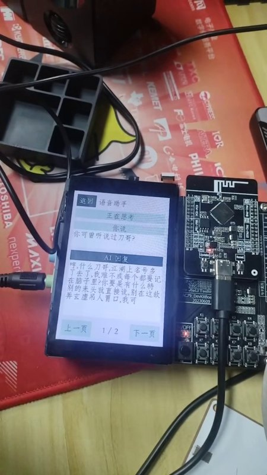
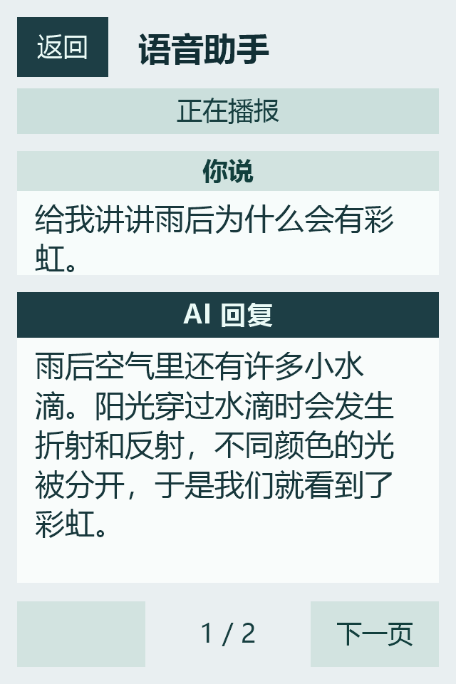
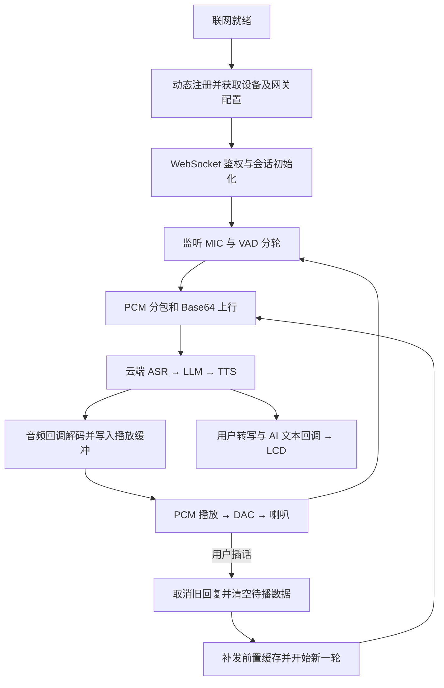

# AC791N 实时智能语音助手

在杰理 AC791N / WL82 开发板上实现的**云端实时语音交互终端**。用户对着板载麦克风说话，设备通过 OneSDK / WebSocket 上传音频，云端完成 ASR → LLM → TTS，回复经开发板喇叭播出；LCD 显示识别文字、AI 回复和会话状态。

项目在 SDK 的 Hello 工程上新增语音应用，重点是 **SDK 二次开发、异步音频流、VAD 分轮、插话打断、连接恢复和 UI 稳定性**。仓库提供应用代码、SDK 修改覆盖层及配套 UI 资源，需与指定上游 SDK 一起构建。

## 项目流程与面试复盘

[阅读我的项目流程与技术面试复盘](docs/AC791N项目流程与技术面试复盘.md)：从设备启动、联网鉴权、音频收发和打断讲起，再整理平台选型、I²C / SPI / UART 与回调函数。

## 实现效果

### 开发板实机演示

**[▶ 观看约 60 秒实机演示视频](docs/media/ac791n-demo.mp4)**

视频为本项目开发板拍摄，已转码压缩并保留原音频。打开视频文件可播放或下载，建议配合声音观看。

  
  
  

从左到右依次为**等待语音输入、回复文本显示、后续对话更新**。截图提取自同一段实拍视频，不是 UI 渲染图。

视频可观察到 LCD 上的用户转写、AI 回复、会话状态与页数更新。该演示用于展示实际交互，不用于计算语音识别准确率、首包延迟或连续运行稳定性；插话和断线恢复的实现另见下文代码与验证说明。

### 界面设计预览

下图是 UI 工程配套的**静态布局预览**，用于说明“会话状态、用户转写、AI 回复、翻页”等区域。示例文案不代表某次实机识别结果。

### 使用后能看到和听到什么

| 交互 | 操作 | 系统表现与实现位置 |
| --- | --- | --- |
| 开始对话 | 联网后向板载 MIC 说一句话并停顿 | VAD 分轮并上传 PCM；云端返回语音，经播放缓冲输出到喇叭 |
| 查看字幕 | 停留在语音助手页面 | 用户转写和 AI 文本回调更新到对应区域，显示当前对话状态 |
| 插话打断 | 回复播放期间再次说话 | 满足本地判定条件后取消旧回复、清空待播数据，补发前置 PCM 并开启新一轮 |
| 调节音量 | 按板载音量键 | 单击/长按事件调整播放音量，复用 SDK 音频服务 |
| 空闲与断线 | 会话空闲，或连接中断后恢复 | 空闲 PING 保活；会话退出后重新初始化、建立连接 |
| 返回菜单 | 操作返回入口 | UI 页面切换与业务状态配合，避免联网事件无条件抢占聊天页 |

上述功能依据已有源码和开发板联调记录。单个演示片段只证明其中出现的场景；断网恢复、长时间运行与不同噪声环境需要分别验收。

## 语音数据怎样流动

| 环节 | 当前代码配置或行为 |
| --- | --- |
| 音频格式 | 16kHz、16bit、单声道 PCM |
| 上行分包 | `MIC_PACKET_BYTES=3200`，对应 100ms PCM；这是配置换算，不是响应延迟实测 |
| 任务分工 | 语音业务任务组织分轮，WebSocket 任务运行服务循环和发送队列 |
| 回复播放 | 下行音频 Base64 解码后写入播放缓冲，随接收进度输出 |
| 插话处理 | VAD 与幅度条件确认，取消云端回复、清空待播数据、恢复前置 PCM |
| 会话退出 | 停止音频流并等待 WebSocket 任务退出，释放上下文后重建会话 |

## SDK 中具体做了什么

| 改动 | 涉及文件 | 解决的问题 |
| --- | --- | --- |
| 新增语音应用 | `hello_realtime_voice.c/.h` | 把 WiFi、注册、会话、采集、播放和重连串成应用流程 |
| 硬件智能体接入 | `onesdk.c`、`infer_realtime_ws.c/.h` 等 | 适配网关地址、bot 路径和握手签名头 |
| 会话事件回调 | `onesdk_rt.c`、`onesdk.h` | 把音频、转写、AI 文本和会话事件交给应用 |
| 音频缓冲接口 | `audio_input.c/.h` | 支持剩余音频读取、回复写入、待播判断与清空 |
| 事件循环唤醒 | `infer_realtime_ws.c`、语音任务 | 避免消息只堆在 ring，补充 writable 触发与 `lws_cancel_service` |
| UI 与按键处理 | `ui_main.c`、`app_main.c` 等 | 状态与绘制分离，处理文本长度、列表指针、按键和媒体任务竞争 |

以上为 SDK 及示例基础上的应用开发与适配，不把厂商原有驱动、音频算法或云端模型当作个人从零实现。

## 实际调试案例

| 现象 | 如何区分问题 | 处理方式 |
| --- | --- | --- |
| WebSocket 握手 HTTP 500 | 检查响应错误与网关路径 | 补充硬件智能体要求的 bot 参数 |
| 101 成功但没有任何下行 | PC 端分段复现注册、配置、握手与音频事件，结合云端排查 | 修正失效的智能体推理接入点配置 |
| 音频已入队却发不出去 | 对照 ring 状态与实际发送回调 | 事件循环检查待发队列，触发 writable，入队唤醒服务循环 |
| 插话时句首丢失 | 检查 VAD 确认前读取的 PCM 是否被丢弃 | 增加前置缓存，在新一轮开始时补发 |
| UI 页面重入或文本断言 | 对照当前任务、绘制回调和控件长度限制 | 回调置标志、定时刷新、防重入并限制绘制长度 |

## 关键代码

| 路径（均位于 overlay 下） | 作用 |
| --- | --- |
| `apps/demo/demo_hello/hello_realtime_voice.c` | 会话主流程、VAD 分轮、打断与前置缓存 |
| `apps/demo/demo_hello/include/hello_realtime_voice.h` | 功能开关和留空的接入配置 |
| `apps/common/LLM/onesdk/src/infer_realtime_ws.c` | 鉴权适配、发送队列、事件循环及保活 |
| `apps/common/LLM/onesdk/src/onesdk_rt.c` | 音频、文本及会话事件回调 |
| `apps/common/LLM/audio/audio_input.c` | 音频采集、播放缓冲及音量接口 |
| `apps/common/example/Devkitboard_test/ui_main.c` | 聊天页、刷新与交互处理 |
| `apps/demo/demo_hello/board/wl82/AC791N_DEMO_DEMO_HELLO.cbp` | Code::Blocks 工程 |

## 复现步骤

1. 获取 [上游 SDK](https://gitee.com/Jieli-Tech/fw-AC79_AIoT_SDK)，切换到基线 `0617f4cc09685332aaf1104893718291c54ee5bb`，在独立副本上操作。
2. 在仓库根目录运行 `python apply_overlay.py --sdk "你的 SDK 副本路径"`，按相同结构覆盖项目文件并自动解压生成图片源码。会覆盖目标副本内的同名文件，请使用单独的基线副本。保留上游其他文件和库。
3. 使用杰理官方 pi32v2 工具链与 Code::Blocks，打开 Hello 的 `.cbp`；如本机安装位置不同，调整工具链搜索路径。
4. 在自己的本地副本中填写 `hello_realtime_voice.h` 的云端实例、产品、设备和智能体配置；在 `wifi_demo_task.c` 填写 WiFi。**不要把填写后的配置提交到公开仓库。**
5. 检查 SDK 的功能宏、MIC 通道、屏幕及板级配置是否匹配硬件；联网后依次确认注册、配置获取、WebSocket、session 和音频事件。
6. UI 使用配套 ILI9488 320×480 / FT6236 工程。`ui_project/` 为界面源与素材，`overlay/cpu/wl82/tools/ui_res/` 为当前配套资源；更换硬件或修改 UI 后应通过厂商 UI 工具重新生成并同步资源 ID。
7. Clean → Rebuild 后按厂商流程烧录。验收应包含麦克风输入、喇叭完整播放、插话、音量和断线场景。

## 验证范围

历史开发板联调记录确认语音输入、云端回复及喇叭输出已跑通，并包含 UI、按键和打断问题的修复。当前覆盖层来自本地源码快照；本次公开整理仅做文件、配置清理与工程引用检查，未重新烧板验收。不同云产品配置或 SDK 版本可能需要重新适配。

没有提供未经测试的延迟、准确率、长期稳定性或优化百分比。ASR/LLM/TTS 在云端执行，不是端侧模型训练或 NPU 推理项目。

## 代码来源

基于杰理 SDK 和示例二次开发，包含协作编写与调试的应用代码。上游基线、许可和发布范围见 [UPSTREAM.md](UPSTREAM.md)，源文件清单与摘要见 `SOURCE_MANIFEST.json`。仓库不包含本地凭据、课程原文、云端账号信息、完整 SDK 二进制库或编译产物。

生成的 `logo.c` 采用 `logo.c.gz` 无损存放，由覆盖脚本恢复；图形资源不作为个人算法源码展示。
