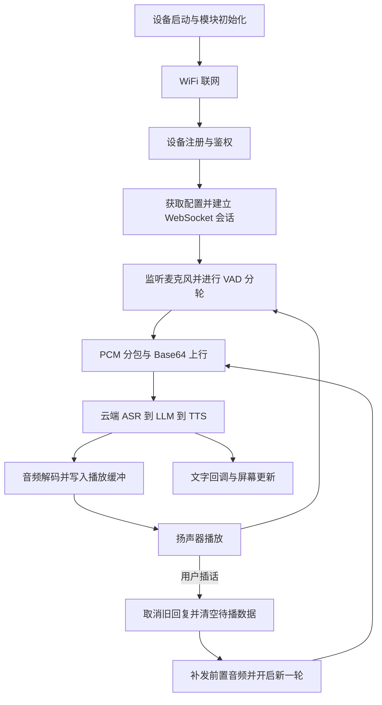

# 我的杰理 AI 语音助手项目

日期：2026 年 11 月 24 日

这篇文章从我的项目流程讲起，再整理平台选型、通信接口和回调函数等面试问题。项目基于杰理 SDK 和示例二次开发；我主要完成设备端业务、云服务接入与适配，复用厂商底层能力，云端负责 ASR、LLM 和 TTS。

## 一 我先介绍项目的整体流程

我做的是一个基于杰理 AC791N / WL82 平台的联网 AI 语音助手。用户进入对话后，设备采集麦克风音频，上传到火山引擎的实时对话服务。云端完成语音识别、大模型处理和语音合成，设备接收返回的文字和音频，更新屏幕并播放语音。



### 1 启动和联网

设备启动后，需要完成网络、音频、界面和按键等相关模块的初始化。

用户进入 AI 聊天时，我先检查网络状态。如果设备没有联网，就跳转到配网页；联网成功后，再进入后续的对话流程。我也处理了页面状态，避免联网事件无条件抢占当前界面。

### 2 注册鉴权和获取配置

网络连接成功后，我需要先让云端确认设备身份，再取得建立实时对话所需的配置。

```text
准备设备注册参数
→ 使用 HMAC-SHA256 生成签名
→ 发起 IoT 动态注册
→ 调用 GetLLMConfig 获取配置
→ 按返回格式进行 AES-CBC 解密
→ 使用取得的配置建立实时会话
```

这部分我遇到过连续返回 401 的问题。我重点核对了签名参数、auth_type、instance_id 是否参与签名，以及 Bearer 请求头的拼装方式。

我的体会是，鉴权失败时要核对参与计算的原始字段和最终请求，不能只看接口有没有被调用。公开文档只说明流程，实际凭据保留在本地配置中。

### 3 建立实时连接

拿到配置后，我使用 libwebsockets 建立 WebSocket 连接，通过 TLS 保护通信过程。连接建立后，事件循环持续处理连接、可写、接收和断线等事件。

我在这里区分两个状态：网络连接建立成功，以及业务音频能够正常收发。握手成功只说明连接建立，采集、队列、发送回调和会话配置仍然需要分别验证。

### 4 采集音频并上传

我的上行音频采用 16 kHz、16 bit、单声道 PCM，每个数据块为 100 ms。

```text
每秒原始 PCM 数据量 = 16000 × 2 × 1 = 32000 字节
每个 100 ms 数据块 = 3200 字节
```

代码中的 `MIC_PACKET_BYTES=3200` 对应这一分包大小。这个 100 ms 是音频块时长，不是端到端响应延迟实测。

我把音频采集与网络发送分开处理：采集侧产生音频，业务侧组织分轮并进行 Base64 编码，再由网络发送队列和事件循环完成上传。

```text
麦克风采集
→ 读取 PCM 并组织分轮
→ Base64 编码与协议封装
→ 放入发送队列
→ 事件循环安排可写通知
→ 在可写回调中发送
```

PCM 原始数据量约为 32 kB/s，即 256 kbit/s。Base64 通常还会使数据量增加约三分之一，此外还有消息封装和网络协议开销，所以不能把 32 kB/s 当作实际网络带宽。

当发送速度跟不上采集速度时，队列会积压。我采用过队列拥塞时放弃本次音频块、避免无限等待的处理，防止积压拖住整个会话。音频与关键控制消息需要区分处理。

### 5 接收结果并播放

云端返回消息后，我按照消息类型处理文字和音频。

```text
接收云端消息
→ 协议解析与事件分发
→ 文字交给聊天界面
→ 音频 Base64 解码后写入播放缓冲
→ 音频链路持续输出到扬声器
→ 更新对话状态
```

我实现了聊天界面，用环形滚动的方式保留最近五条消息，并处理文本控件单次写入长度有限的问题。

网络接收和界面重绘要区分职责。网络回调完成必要的数据处理，界面通过相应的刷新机制更新，避免复杂重绘阻塞通信或引发重入。

### 6 用户打断

AI 播放回复时，用户可能直接插话。我结合 VAD、峰值和均值门限，以及持续确认条件，减少瞬时噪声引起的误触发。

当前代码中的 `BARGE_IN_CONFIRM_BYTES=5120`，按每秒 32000 字节计算，对应约 160 ms 的音频量。它表示确认所需的有效音频量，不是精确的打断延迟实测。

```text
持续采集并更新前置缓存
→ 检测到有效说话
→ 满足打断确认条件
→ 取消旧回复并清空待播数据
→ 补发前置音频
→ 继续上传新一轮音频
```

我保存前置音频，是因为检测需要时间。如果确认用户说话后才开始上传，句首可能已经丢失。

当前代码的 `PRE_ROLL_BYTES=20480`，约为 20 KiB。在上述音频格式下，可保存约 0.64 秒音频，也就是面试中概括的“约 0.6 秒前置缓存”。

这部分实现的是说话检测和句首补偿，不能直接等同于 AEC 回声消除。扬声器播放时的误触发情况，需要结合回声处理能力和实际场景分别验证。

### 7 保活和异常恢复

我处理了空闲 PING 保活、断线后的会话重建，以及与本地音乐、蓝牙功能的共存。

会话退出时，需要停止音频流，协调 WebSocket 任务退出，释放连接上下文后再建立新的会话。我的关注点是一次对话结束后，下一次还能正常进入，而不是只让第一次连接成功。

## 二 我在项目中遇到的关键问题

### 1 握手成功 但音频发不出去

我遇到过连接已经建立、音频也已入队，但上行没有正常工作的问题。

我的排查顺序是：

```text
采集有没有数据
→ 数据有没有入队
→ 事件循环有没有持续运行
→ 可写回调有没有触发
→ 发送接口有没有执行
```

我定位到业务线程请求可写通知后，当前移植环境的事件循环没有按预期被唤醒。处理时由 WebSocket 事件循环线程检查待发数据并安排可写通知，同时在入队处配合服务循环唤醒，上行恢复正常。

我由此理解了事件驱动方式：有数据要发送时，先安排可写通知，再由回调完成发送。libwebsockets 的 WebSocket 数据发送应发生在对应的可写回调中；跨线程唤醒服务循环通常使用 `lws_cancel_service()`。[libwebsockets 官方说明](https://libwebsockets.org/lws-api-doc-master/html/md_READMEs_README_coding.html)

### 2 UI 操作引发异常

我遇到过 UI 回调内直接进行复杂重绘，导致任务栈溢出和设备重启的问题，也处理过页面重入与文本长度限制相关异常。

我把状态更新和实际绘制分开，采用回调置标志、定时刷新、防重入等方式处理。排查时关注当前任务、回调调用链、栈使用和控件限制，而不是只检查堆内存是否足够。

## 三 我怎样解释平台选型

从项目需求来看，我需要 WiFi 联网、音频采集播放、蓝牙、本地音乐和界面交互。

杰理 AC791N 平台及 SDK 提供相关无线、多媒体和应用框架，使我能够复用基础能力，把开发重点放在云端协议接入、音频缓冲、任务协作和交互上。[杰理官方 SDK 概览](https://doc.zh-jieli.com/SDKWiki/master/Jieli-Tech/fw-AC79_AIoT_SDK/1-overview/1.1-sdk-overview.html)

如果面试官问选型看什么，我会从以下方面分析：

1. **功能是否满足**：联网、录音、播放、蓝牙和显示是否具备。
2. **资源是否够用**：音频缓存、TLS、网络库和 UI 是否有足够内存。
3. **SDK 是否适合**：现有框架能复用多少，需要适配多少。
4. **开发和维护成本**：工具链、日志、调试方式和文档是否方便。
5. **产品约束**：成本、功耗和启动时间是否满足需求。

与 Linux SoC 比较时，我会考虑系统与工具生态、资源需求、启动过程和维护复杂度；与其他联网 MCU 比较时，我会考虑无线与音频能力、内存和 SDK 适配工作量。

以上是我对平台适配性的分析。我还没有提供完整的多平台成本、功耗和性能实测对比，也不把在既定平台上完成开发说成自己主导了整个平台选型。

## 四 我怎样介绍常用通信接口

### 1 I²C

我把 I²C 理解为一种常用于外设控制和寄存器访问的同步串行总线，主要信号是 SCL 时钟线和 SDA 数据线。常见连接采用开漏输出，需要上拉电阻。

控制器通过设备地址选择外设，传输中使用 ACK/NACK 表示应答，常用于传感器、EEPROM 和音频 Codec 等器件。

典型读寄存器流程是：

```text
START
→ 设备地址和写方向
→ 寄存器地址
→ 重复 START
→ 设备地址和读方向
→ 读取数据
→ 最后一个字节后发送 NACK
→ STOP
```

具体寄存器地址长度和时序要看器件手册。如果设备没有应答，我会检查供电、复位、设备地址、引脚复用、上拉电阻和总线波形。

### 2 SPI

SPI 是同步串行接口，典型四线方式包括 SCLK、MOSI、MISO 和 CS。通常通过片选选择目标设备，典型四线方式支持全双工，常用于 Flash、显示屏和传感器。

我会重点确认通信频率、CPOL、CPHA、位序和片选时序。CPOL 决定时钟空闲电平，CPHA 决定采样时序。

```text
配置时钟与模式
→ 有效片选
→ 发送命令 地址和数据
→ 接收返回数据
→ 结束片选
```

SPI 没有统一规定的设备地址和 ACK 机制，命令和数据格式取决于具体器件协议。

### 3 UART

UART 是异步串行接口，常见使用 TX、RX，并连接信号参考地。双方约定波特率和帧格式，不需要随数据传输一根时钟线。

```text
起始位 → 数据位 → 可选校验位 → 停止位
```

例如 115200、8N1，表示波特率 115200、8 位数据、无校验、1 位停止位。我主要把串口用于日志与调试。

出现乱码时，我优先检查波特率、时钟和帧格式；没有数据时，检查接线、引脚复用和初始化。UART 与 RS-232、RS-485 不能直接等同，还需要区分电气接口。

### 4 三种接口怎样比较

| 项目 | I²C | SPI | UART |
| --- | --- | --- | --- |
| 同步方式 | 同步 | 同步 | 异步 |
| 典型信号 | SCL SDA | SCLK MOSI MISO CS | TX RX |
| 目标选择 | 设备地址 | 通常使用片选 | 通常为点对点连接 |
| 常见用途 | 寄存器配置与低速外设 | Flash 显示和数据传输 | 日志 命令和模组通信 |
| 关注点 | 地址 ACK 上拉 | 模式 片选 时序 | 波特率 帧格式 电平 |

我会根据原理图和板级配置说明具体器件使用的接口，不会仅凭器件类型推断。另外，I²C 和 I²S 不一样：前者常用于控制寄存器，后者主要用于数字音频数据传输。

## 五 我怎样解释回调函数

### 1 什么是回调函数

我的理解是：先把处理函数注册给框架，等指定事件发生时，再由框架调用。在 C 中，通常通过函数指针实现。

```text
实现处理函数
→ 注册函数指针
→ 框架发现事件
→ 调用处理函数
→ 处理函数返回
→ 框架继续运行
```

按键按下、网络收到数据、连接断开，都可以通过回调通知业务代码。

### 2 我的项目怎样使用回调

最直接的例子是网络通信。我先把待发数据交给队列，再由网络事件循环根据可写状态调用回调并发送，把数据产生时间和网络可发送时间分开。

下行也通过回调分发。项目的 `receive_audio()` 接收音频事件并进行 Base64 解码，后续交给播放缓冲；用户转写和 AI 文本通过对应事件更新到界面。

进入可写回调后，我仍然需要检查是否存在待发数据，因为框架也可能额外产生可写通知。

### 3 回调里要注意什么

我首先确认回调运行在哪个上下文，然后决定里面能做什么。

- 硬中断上下文不能睡眠。
- 网络事件循环中不能长时间阻塞。
- 界面操作要遵守 UI 框架要求。
- 保存回调传入的数据前，要确认缓冲区在返回后是否仍然有效。
- 访问共享队列时，需要考虑同步。
- 耗时处理可以通过队列交给其他任务。
- 销毁对象时，要协调仍在执行或尚未处理的回调。

回调函数不等于中断函数，也不意味着框架自动创建了新线程。

## 六 我准备继续补充的内容

- 实际芯片完整型号、SDK 版本和 RTOS 信息。
- 平台由谁确定，以及我的选型参与范围。
- 音频、屏幕和其他外设的实际连接接口。
- 任务、队列和回调的更完整代码追踪。
- 本次面试尚未回忆起来的其他问题。

## 七 我对照的关键代码

| 文件 | 主要内容 |
| --- | --- |
| [hello_realtime_voice.c](../overlay/apps/demo/demo_hello/hello_realtime_voice.c) | 会话流程 分轮 打断 前置缓存与音频回调 |
| [infer_realtime_ws.c](../overlay/apps/common/LLM/onesdk/src/infer_realtime_ws.c) | 发送队列 WebSocket 事件循环与保活 |
| [onesdk_rt.c](../overlay/apps/common/LLM/onesdk/src/onesdk_rt.c) | 实时会话协议与事件分发 |
| [audio_input.c](../overlay/apps/common/LLM/audio/audio_input.c) | 音频采集与播放缓冲 |
| [ui_main.c](../overlay/apps/common/example/Devkitboard_test/ui_main.c) | 聊天界面与刷新处理 |

实际演示、复现步骤和验证范围见[项目首页](../README.md)。

